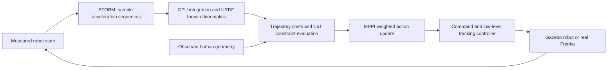

# What computes MPPI rollouts?

STORM simulates candidate robot motion with its own mathematical model, implemented
as batched PyTorch operations on the GPU. It does not require a separate simulator
application to compute those rollouts. Gazebo simulates the robot that executes
the chosen commands in this ROS demonstration.

| Component | Role in this handoff |
| --- | --- |
| STORM / CaT MPPI | Samples actions, predicts candidate trajectories and scores them |
| URDFKinematicModel | Integrates joint accelerations; computes robot link geometry |
| Gazebo Fortress | Simulates the robot's physical response to low-level commands |
| RViz | Displays robot state, targets, capsules and planning markers |
| Isaac Sim / Isaac Lab / Isaac Gym | Not used by this launch or its MPPI rollouts |



The preserved profile uses 1,000 candidate sequences, 50 steps and 20 ms per step:
approximately one second of future motion for each candidate. These are tensor
arrays, not 1,000 independent Gazebo/Isaac worlds. The sampled action is joint
acceleration. The integration is equivalent to:

```text
qd[k+1] = qd[k] + acceleration[k] * dt[k]
q[k+1]  = q[k]  + qd[k+1] * dt[k]
```

Forward kinematics maps each predicted joint configuration to link poses. STORM
then evaluates goal error, collision distances and other configured costs and
constraint violations. MPPI reweights candidate action sequences, with CaT
modifying the weighting based on violations. The command path sends the next
reference to the tracking controller and replans from updated robot state.
Gazebo does not execute every candidate trajectory; it receives the chosen
commands. During a hardware run the real arm supplies the physical response.

The rollout does not simulate contact dynamics for every candidate. The current
code can evaluate inverse-dynamics torque constraints on the predicted motion;
that does not turn its state propagation into a contact-physics simulator.

## Trace the implementation

1. `storm_kit/mpc/task/reacher_task.py`: selects native `ArmReacher` for this profile.
2. `storm_kit/mpc/rollout/arm_base.py`: constructs `URDFKinematicModel`; its
   `rollout_fn` calls `rollout_open_loop`, then `cost_fn`.
3. `storm_kit/mpc/model/urdf_kinematic_model.py`: batches state integration and
   calls `DifferentiableRobotModel.compute_fk_and_jacobian` from the URDF.
4. `storm_kit/mpc/model/integration_utils.py`: `tensor_step_acc` implements the
   acceleration integration.
5. `storm_kit/mpc/control/mppi.py`: MPPI updates and CaT weighting.

All paths above are under `storm/`. CUDA is selected by the ROS bridge's
`mppi_device: cuda:0`; it is independent of any Isaac installation.

## Why STORM documentation mentions Isaac

The [original STORM Franka example](https://github.com/NVlabs/storm/blob/main/examples/franka_reacher.py)
used Isaac Gym to simulate the robot receiving commands from STORM. The original
supervisor workspace also contains an Isaac Sim/Isaac Lab port of that separate
example. Those simulator examples are not the ROS/Gazebo entry point delivered
here. An unused adapter remains in `storm/storm_kit/sim/backends/` as part of the
copied STORM source; the current ROS launch does not load it or require its Isaac
dependencies. The retained STORM core performs the predictive rollouts in this handoff.

## Human motion and prediction

The included ROS fixture publishes one moving cylinder in COSMIK's MarkerArray
format. RViz displays it; STORM receives collision spheres derived from it.
It is not a physical human character in Gazebo. `world` and `fer_link0` coincide.

Currently each newly observed human geometry is held stationary across the robot
rollout horizon. The research extension must instead compare robot geometry at
future step k with the human geometry predicted for that same time. Publishing
forecast markers alone is insufficient: the collision evaluator must consume the
forecast. See [prediction.md](prediction.md) for data shapes, timing and tests.
